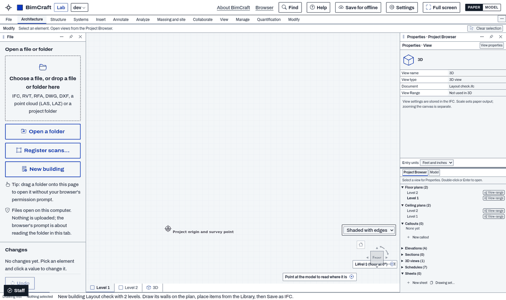
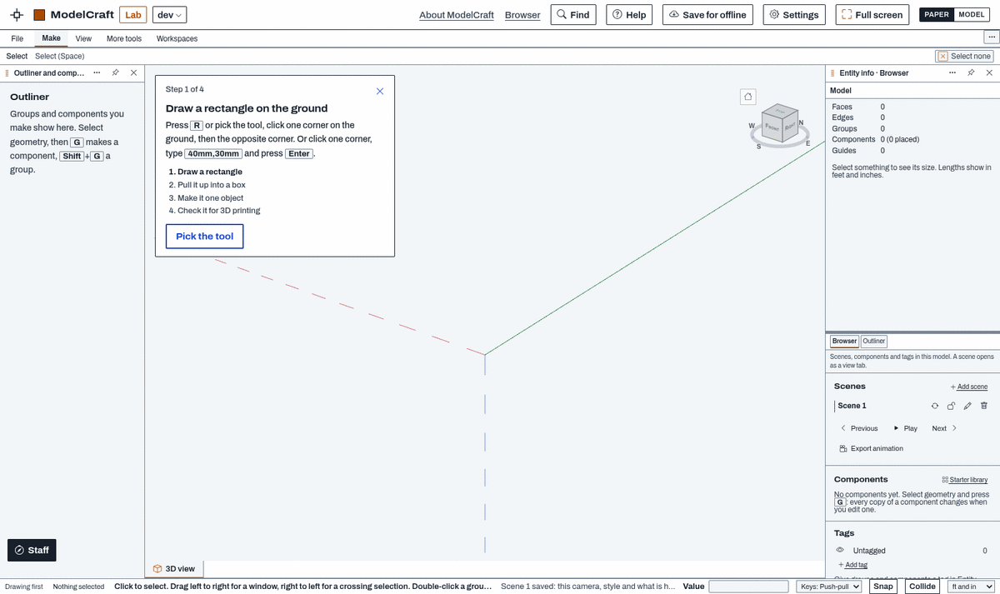

<!-- SPDX-License-Identifier: Apache-2.0 -->
# Make your own workspace layout

A **layout** arranges the CadCraft apps' building blocks — a ribbon, a toolbox, an info box, palettes, view tabs, a status bar and a
few more — around the drawing. It is a small JSON file, `<name>.ccworkspace.json`: data only, no code and no CSS. The same file
works in every app: each app fills the blocks with its own tools.

The apps ship three layouts: **CadCraft classic** (the default), **Ribbon and project browser** and **Toolbox and info box**. The two
last ones are files in exactly the format below and load through exactly the path your file takes. This guide shows how to write a
fourth, test it, and share it as an add-on.

> **Status (CadCraft 0.7 lab):** the layout engine, the format, Import / Export in Settings and add-ons of kind `workspace` are built,
> and all eight apps have their adapter (the code that fills the blocks): CadCraft, BimCraft, ModelCraft, MarkupCraft, TakeoffCraft,
> CivilCraft, DetailCraft and PartCraft. Every one of them passes the conformance test below with both built-in layouts, in English,
> Spanish and Indonesian.

Contents: [How CadCraft uses your layout file](#how-cadcraft-uses-your-layout-file) · [The building blocks](#the-building-blocks) ·
[The format, field by field](#the-format-field-by-field) · [The two built-ins](#the-two-built-in-layouts-worked-examples) ·
[How the app treats your file](#how-the-app-treats-your-file) · [The contract and the test](#the-contract-and-the-test) ·
[Naming](#naming) · [Packing it as an add-on](#packing-it-as-an-add-on) · [Review](#review) ·
[What a layout cannot do](#what-a-layout-cannot-do-and-how-to-propose-a-new-block)

## Start in the app: Arrange your own layout

You don't have to write the file by hand. In any app, **Settings › Global › Layout › Arrange your own layout…** lets you choose which panel holds
which palettes, where the toolbox goes, a ribbon or the toolbar, what the info box, quick bar and view bar hold, the view tabs, the edit palette
and the look; it offers only the blocks that app can fill. **Use this layout** saves it as your own layout file (`my-<name>`), and **Export this
layout** writes it out as a `.ccworkspace.json` you can edit, test and pack as an add-on with the steps below.

A layout arranges the blocks; a **work environment** (Settings › Global › Layout › Work environments, `.ccenv.json`) is a person's whole setup —
the layout chosen, menu style and keys, toolbar style, panels, My tools — and is not an add-on kind.

## How CadCraft uses your layout file

```
  your .ccworkspace.json ─┐
  a built-in layout ──────┼──► text ──► importLayout()   ──► resolveLayout(layout, this app) ──► mountWorkspaces()
  an add-on of the app ───┘             read as untrusted:     blocks the app has, filled by      blocks placed around <main>,
                                        unknown keys dropped,  its adapter; blocks it lacks are   in the app's panels and over the
                                        values bounded,        dropped with a note                drawing; the panel manager,
                                        a bad file refused                                        menu styles and keys keep working
                                              │                         │
                                              ▼                         ▼
                                   message, classic stays     nothing fits: message, classic stays
```

### 1. Where a file comes from

| Source | How it reaches the app | In Settings › Global › Layout |
|---|---|---|
| **Built-in** | `assets/workspaces/<id>.ccworkspace.json` in the apps' shell; the page carries its text (`AppBuilds::workspaceConfig()` → `<script id="cc-workspace">`) for the layouts the app's build lists | the three radios at the top |
| **An add-on of the app** (kind `workspace`) | a `workspace/` folder in the app's build: `index.json` + the files (`WorkspaceAddons::fromDir()` checks them on the server); the page carries their text the same way. The add-on directory lists them at **getcadcraft.com/addons?kind=workspace** with a download link | "From add-ons and files", marked *add-on* |
| **Import** | Settings › Global › Layout › **Import a layout…**, or a file dropped on the Settings dialog (`app-settings.js` → `ccShellWorkspace.importText()` → the engine's `importText()`); the clean file is kept in this browser (`localStorage` `cc-workspace-files`, up to 8), shared by every app here | "From add-ons and files", marked *imported*, with a remove button |
| **Studio (desktop)** | the same three paths, from the first Studio build that carries the layout engine (Studio packs the apps' browser editions; that build is not made and tested yet) | the same |

**Export this layout** writes the layout in use as a file to share. To try a layout on one page without picking it, add
`?workspace=<value>` to the app's address: a built-in's id (`docked`, `toolbox`), `addon:<id>`, or `file:<id>` for one you imported.
Not built yet: Studio does not read layouts from its add-ons folder; the directory has no one-click Install (download, then Import) and no upload for layouts (a layout reaches the directory by shipping in an app's build, after review).

### 2. What happens when it loads

1. **Read as untrusted.** `importLayout(text)` (`assets/js/app-workspace-format.js`) refuses a file over 64 kB, one that is not JSON, not
   `cadcraft-workspace`, a newer version, with no valid id or name, or with nothing placed. Everything else is **validated and bounded**:
   unknown keys are dropped and counted, values outside the lists below are dropped, a block in a place it cannot go is dropped with a
   note. See [How the app treats your file](#how-the-app-treats-your-file) for every limit.
2. **Resolved against this app.** `resolveLayout(layout, caps)` keeps the blocks this app's adapter can fill: its ribbon (from its
   ribbon menu style), its toolbox groups, its info-box and bar **slots**, its **palettes**, its **views** and the **actions** it runs.
   A block or a slot the app lacks is dropped with a note (Settings shows how many things were left out; the conformance test prints
   them). If nothing is left, the app keeps its classic layout and says why.
3. **Chosen.** Picking it in Settings saves the choice in `localStorage` `cc-workspace` (`docked`, `addon:<id>`, `file:<id>`); every app on
   this browser reads the same choice. CadCraft classic removes it.
4. **Before the first paint, next time.** A tiny script at the top of every app page (`app-shell.inc`) sees the choice, checks that this
   page can offer it and that the window is wider than a phone, and marks the page (`html[data-cc-ws-boot]`). The classic layout stays out
   of sight until the layout is mounted, so it never flashes first. (A start that fails shows the page after 10 seconds.)
5. **Mounted.** The app calls `mountWorkspaces(adapter)` (`assets/js/app-workspace.js`); the engine builds each block where the file puts
   it — above or below `<main>`, inside the app's panels, or over the drawing — and **moves** the app's own controls into them (never
   copies), so the app's panels keep docking, floating and moving to their own windows, and menu styles, keys and add-ons keep working.
6. **Back to classic.** Picking CadCraft classic (or a layout the app cannot use) puts every control back where it was.

At phone widths every app keeps its phone layout; your layout comes back on a wider window.

### 3. One file, every app

The same file arranges the blocks in all eight apps; each app fills them with its own tools. Here is
[`examples/layout-drawing-first`](../examples/layout-drawing-first/workspace/drawing-first.ccworkspace.json) — the ribbon starts folded
to its tabs, the palettes go to the right panel, the view tabs run along the bottom:

**In BimCraft** (its own adapter): Doc's ribbon of BimCraft tools, Properties and the Project Browser in the right panel, a tab for each
level and 3D at the bottom.



**In ModelCraft** (its own adapter): ModelCraft's ribbon menu style (Make, View, More tools) plus its Workspaces tab, folded to the
tabs; Entity info as Properties over a browser of scenes, components and tags (the Outliner is the panel's own tab) in the right panel;
the 3D view and each scene as view tabs at the bottom. Nothing in the file is left out in ModelCraft.



### 4. What a layout cannot do

No code, no CSS, no new tools, no new buttons, no colours of its own. A layout can only pick and place the blocks below and choose from
the look options. A tool it shows is always the app's own. If your idea needs a block that does not exist,
[propose one](#what-a-layout-cannot-do-and-how-to-propose-a-new-block).

## The building blocks

Places: around the app's `<main>` — **top**, **bottom**; inside the app's panels — **left-panel**, **right-panel**; over the drawing —
**stage-top** / **stage-bottom** (full width), **stage-left** / **stage-right** (columns), **view-top** / **view-bottom** (over the
drawing, between the columns); **none** (left out; for the app's toolbar: hidden).

```
┌──────────────────────────── top ─────────────────────────────┐
├──────────┬────────────── stage-top ───────────────┬──────────┤
│          ├────────────┬── view-top ──┬────────────┤          │
│   left-  │ stage-left │   (drawing)  │stage-right │  right-  │
│   panel  │            ├─ view-bottom ┤            │  panel   │
│          ├────────────┴ stage-bottom ┴────────────┤          │
├──────────┴──────────────────────────────────────────┴──────────┤
└─────────────────────────── bottom ───────────────────────────┘
```

| Block | Places (first = default) | Options | What fills it |
|---|---|---|---|
| `titlebar` | top | `quick` [actions], `inventory` true | the app's logo and name, quick buttons, the document's name, Full screen, Help, Settings. It replaces the app bar. |
| `ribbon` | top, stage-top | `file` [actions], `collapse`, `collapsed`, `tearOff` | the app's ribbon menu style: tabs → groups → large tools and stacks of three small ones; a File button when `file` names actions |
| `options` | top, bottom, stage-top, stage-bottom | `commands` [actions] | what the running tool asks for (its options row), or what to do next |
| `toolbar` | none, stage-top, stage-bottom | — | the app's own toolbar (every toolbar style, Arrange, lock) |
| `infobox` | stage-top, stage-bottom | `slots` [names] | labelled groups of the app's slots; `tool` = the running tool's options, or the selection with the picked element's main fields (small twins of its Properties fields) |
| `toolbox` | stage-left, stage-right | `collapse`, `tearOff`, `mine` | a column of the app's tools, in its toolbar's groups; `mine` adds "My tools", empty slots a person fills with any tool or command |
| `petpalette` | float | — | the app's edit commands for the picked element (move, copy, rotate, … delete) and Properties, by the pointer after a click in the drawing; Esc or the wheel puts it away |
| `palettes` | left-panel, right-panel | `upper` name, `lower` [names] | two palettes stacked inside an app panel (the panel keeps its grip); `panel` = that panel's own content |
| `viewtabs` | view-top, view-bottom | `mode` `open` or `all` | `open`: a tab per opened view, closable; `all`: a tab for every view |
| `viewbar` | view-bottom, view-top | `slots` [names] | the current view's name and the app's view slots |
| `quickbar` | stage-bottom, stage-top, bottom | `slots` [names] | a strip of the app's slots |
| `statusbar` | bottom | — | the app's status line, the selection count, the layout's name |

Pictures of the blocks in the two built-ins: [Ribbon and project browser](layouts/docked-bimcraft.png) (titlebar, ribbon, options, palettes,
view tabs, view bar, status bar) · [Toolbox and info box](layouts/toolbox-bimcraft.png) (toolbar strip, info box, toolbox with My tools, navigator palettes on the right, view tabs, quick bar; the edit palette shows only while something is picked).

```
titlebar   ┌─▣ App ▸ [open][save][undo][redo] ── document name ── [what each tool does][⛶][?][⚙]─┐
ribbon     │ File │ Home │ Insert │ …                                                      [⋯] │
           │ ┌──────┐┌──────┐┌────────┐  ┌─────────┐                                           │
           │ │ Line ││ Arc  ││▫ Trim  │  │ ▫ Move  │      large tools, stacks of three small     │
           │ └──────┘└──────┘│▫ Extend│  │ ▫ Copy  │                                           │
           │   Draw           Modify       Edit         ← group names (Settings can hide them)   │
options    │ Modify │ Select an element.                 [the tool's own options]   [Clear sel] │
           └───────────────────────────────────────────────────────────────────────────────────┘
toolbox    ┌ Toolbox ⋯ ┐    infobox ┌ Level and plan ┬ Selection / the tool ────────┬ Document ┐
           │▾ Design   │            │ [Level 1][Plan]│ 2 selected  [Properties]     │ [⤢][🖨]  │
           │ ▫ Wall    │            └────────────────┴──────────────────────────────┴──────────┘
           │ ▫ Door    │    viewtabs  [▫ Level 1] [▫ Level 2] [◇ 3D]          (all)
           │▾ Systems  │              [◇ {3D} ×] [▫ Level 1 ×]                 (open)
           └───────────┘    viewbar   {3D}  Scale [Fit ▾]  Detail [Coarse ▾]  [View range] [Fit]
palettes   ┌ Properties ─────────┐    quickbar  [Plan][Split][3D]   Units [ft and in ▾]
           │ …                   │    statusbar Ribbon and project browser · 2 selected · Saved.
           ├═════════════════════┤
           │ Browser │ Panel     │
           └─────────────────────┘
```

**Actions** a title bar, File button or options bar may name: `open`, `save`, `undo`, `redo`, `select`, `clear`, `fit` (each app maps them
to its own commands). **Slots** and **palettes** are named by the apps, and all eight use the same names: slots `level`, `document`,
`layout`, `units`, `scale`, `detail`, `range`, `fit` (+ the engine's own `tool`); palettes `properties`, `browser` (+ the engine's own
`panel`). Each app fills the ones that mean something to it (CadCraft's `level` is the current layer, CivilCraft's the workspace; only
BimCraft and ModelCraft have a `range`; CivilCraft keeps Properties in its own right panel, so it has no `properties` palette). An app
without a slot or palette your file names simply leaves it out, with a note.

## The format, field by field

```json
{
  "format": "cadcraft-workspace",           // required, exactly this
  "version": 1,                             // required; a newer version is refused, never guessed
  "id": "drawing-first",                    // required: a-z, 0-9, hyphens, 2-40, starts with a letter; not standard / classic / none
  "name": "Drawing first",                  // required, plain text, up to 60 characters (shown in Settings and the status bar)
  "description": "…",                       // optional, up to 300 characters (shown under the name in Settings)
  "author": "…",                            // optional, up to 80 characters
  "license": "CC0-1.0",                     // optional, one license token (the index carries it too)
  "look": {                                 // optional; anything else is dropped
    "density": "regular | compact",         //   compact = smaller ribbon and toolbox buttons
    "outline": "faint | box | none",        //   the ribbon's and the toolbox's tool buttons
    "tabs": "filled | underline"            //   the open ribbon tab: lit in the app's colour, or underlined
  },
  "blocks": [                               // required, up to 16, each block at most once
    { "block": "ribbon", "place": "top", "order": 0, "file": ["open", "save"], "collapse": true, "collapsed": true, "tearOff": true }
  ]
}
```

(The comments are for this page only: JSON files have none.) Every block has `block`, `place` (one of its places; default its first)
and `order` (0–99, the order inside that place; default 0), plus its own options from the table above. `nameKey` and `hintKey` are
for the built-ins: they point at the shell's own translated words (`shell.ws.…`); a key the shell does not have is ignored, and `name` and `description` show as written.

## The two built-in layouts (worked examples)

`docked.ccworkspace.json` — **Ribbon and project browser** (from Doc's — drsurfbum's — workspace for BimCraft):

```json
{ "format": "cadcraft-workspace", "version": 1, "id": "docked", "name": "Ribbon and project browser",
  "look": { "density": "regular", "outline": "faint", "tabs": "filled" },      // barely-there outlines, the open tab lit
  "blocks": [
    { "block": "titlebar", "place": "top", "order": 0, "quick": ["open", "save", "undo", "redo"], "inventory": true },   // replaces the app bar
    { "block": "ribbon", "place": "top", "order": 1, "file": ["open", "save"], "collapse": true, "tearOff": true },
    { "block": "options", "place": "top", "order": 2, "commands": ["clear"] },          // the running tool's options under the ribbon
    { "block": "toolbar", "place": "none" },                                             // the ribbon stands in for the toolbar
    { "block": "palettes", "place": "left-panel", "upper": "properties", "lower": ["browser", "panel"] },   // the left panel's content
    { "block": "viewtabs", "place": "view-top", "order": 0, "mode": "open" },            // a tab per opened view
    { "block": "viewbar", "place": "view-bottom", "order": 0, "slots": ["scale", "detail", "range", "fit"] },
    { "block": "statusbar", "place": "bottom", "order": 0 } ] }
```

`toolbox.ccworkspace.json` — **Toolbox and info box**:

```json
{ "format": "cadcraft-workspace", "version": 1, "id": "toolbox", "name": "Toolbox and info box",
  "look": { "density": "regular", "outline": "box", "tabs": "underline" },
  "blocks": [
    { "block": "toolbar", "place": "stage-top", "order": 0 },                            // the app's toolbar as a strip over the drawing
    { "block": "infobox", "place": "stage-top", "order": 1, "slots": ["level", "tool", "document"] },
    { "block": "toolbox", "place": "stage-left", "order": 0, "collapse": true, "tearOff": true, "mine": true },   // + My tools
    { "block": "palettes", "place": "right-panel", "upper": "browser", "lower": ["properties", "panel"] },   // the navigator
    { "block": "viewtabs", "place": "view-top", "order": 0, "mode": "all" },             // a tab for every view, beside the toolbox
    { "block": "quickbar", "place": "stage-bottom", "order": 0, "slots": ["scale", "detail", "range", "fit", "layout", "units"] },
    { "block": "petpalette", "place": "float" } ] }                                       // edit commands by the pointer
```

No title bar here, so the app bar stays. The palettes go in the right panel: the app's browser on top as a navigator, Properties and the
right panel's own content as tabs under it; the left panel stays the app's own.

## How the app treats your file

| Limit | Value |
|---|---|
| File size | 64 kB (65 536 bytes) |
| Blocks | 16, each kind once; at least one placed (not `none`) |
| `order` | whole number 0–99 |
| `name` / `description` / `author` | 60 / 300 / 80 characters, control characters removed, spaces collapsed |
| `id` | `[a-z][a-z0-9-]{1,39}`, not `standard`, `classic`, `none` |
| Actions in `quick`, `file`, `commands` | up to 12, from the actions list |
| Slots in `slots` | up to 8, `[a-z][a-z0-9-]{0,23}` |
| Palettes in `lower` | up to 4 |
| Imported files kept in one browser | 8 |

Anything else in the file is dropped and counted ("1 thing in it was left out"); nothing in it ever runs.

## The contract and the test

Every layout — the built-ins and yours — must keep the same twelve promises in every app. The conformance test checks each one:

1. Selectable, not a replacement: classic is the default; the choice is only in Settings; switching back puts every control home.
2. Known before the first paint: no moment of the classic layout.
3. The app's engine: every tool shown runs the app's own command, or is greyed and says why; no ribbon tab of only tools the app lacks.
4. The panel manager stays: panels dock, float, move to their own windows and keep their grips.
5. The toolbar's three styles (icons and labels / icons only / labels only) and "Show group names" apply to the ribbon and the toolbox.
6. Tear-off and collapse work as the file says.
7. Our look: the theme's colours (Paper and Model), Archivo, no shadows, the open tab in the app's colour, File plain.
8. Every language fits: no group name or label cut off (English, Spanish, Indonesian).
9. Every kind of file stays in the layout.
10. Esc ends the running tool first, as in classic.
11. Every word is translated text (no raw keys, no "null").
12. No console errors.

Plus: every block where the file puts it, in its order; import → choose → reload with no flash → back to classic; a bad file refused with
the message; a stored file that went bad falls back to classic with the message; phones keep the phone layout.

**Before you send it:** `npm test` in your add-on folder checks the file offline exactly as the apps read it (see the example).
**At review** the CadCraft team runs the full test in the apps:

```sh
node bin/test-app-workspaces.mjs --layout your-layout.ccworkspace.json --apps <app> [--lang es-MX|id] [--shots dir]
```

(In the CadCraft site repository, which is private; it runs once per app, one app at a time, for all eight.)

## Naming

Name a layout for **a way of working**, never for a product: "Drawing first", "Ribbon and project browser", "Toolbox and info box" — not
"<program> style". Product names stay out of the name, the description and the file name; `npm test` checks a list of the common ones.
If people will find it familiar from another program, say so in your add-on's own page, in plain text ("familiar if you use …").

## Packing it as an add-on

```
my-layout/
  workspace/
    index.json                       {"format": "cadcraft-workspace-addons", "version": 1, "addons": [{id, file, name, description, author, license}]}
    my-layout.ccworkspace.json
  test/my-layout.test.mjs            your own expectations (node --test)
  tools/                             copy from examples/layout-drawing-first/tools: layout-test.mjs, layout-pack.mjs,
                                     workspace-format.js (the apps' own validator, byte for byte) and apps.json
  package.json                       "test": "node tools/layout-test.mjs && node --test test/*.test.mjs", "pack": "node tools/layout-pack.mjs"
```

```sh
cp -r examples/layout-drawing-first my-layout && cd my-layout
# rename the .ccworkspace.json, change its id and name, and index.json to match
npm test
npm run pack        # → <id>-layout.zip with workspace/ in it
```

One `index.json` may list several layouts (up to 50). Licenses: the same list as other add-ons (CC0-1.0 is the usual one for a layout).

## Review

The CadCraft team checks: the format and the limits (`npm test`), the name and description (a way of working, no product names, no
claims), that it adds something the built-ins do not, and the conformance test in all eight apps. A layout that passes is
added to an app's build (its `workspace/` folder): it then comes with that app, in Settings › Global › Layout, and is listed at
getcadcraft.com/addons?kind=workspace with a download link. Until then, share the file itself: anyone can Import it.

## What a layout cannot do, and how to propose a new block

A layout is a composition of the existing blocks. If you need a block that does not exist (a block is code: it lives in the apps'
shell, `assets/js/app-workspace.js`, and every app's adapter may need to fill it), open an issue or a pull request on
getcadcraft/addons describing: what the block shows, which places it may go, its options, what an app must offer to fill it, and how
the twelve promises hold for it. New blocks, places and options are added to the format first (`app-workspace-format.js`, version
stays 1 while every older file still reads the same), then to the engine and the test, then to this guide. A file that uses a block
an app does not know yet simply has that block left out there, with a note.
